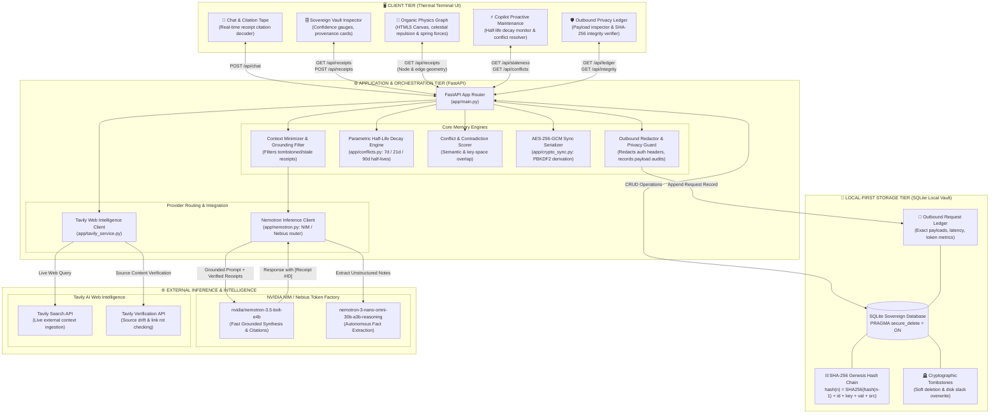

# System Architecture — Receipts (Sovereign Memory Layer)

This document details the architectural topology, data pipelines, cryptographic trust boundaries, and component interactions of **Receipts — Sovereign Memory Layer**.

---

## 1. High-Level Architectural Topology



---

## 2. Memory Lifecycle & Query Data Flow

The following sequence details how memories are ingested, chained, decay over time, and are referenced during live model inference:

```mermaid
sequenceDiagram
    autonumber
    actor User as User / Client
    participant UI as Thermal Terminal UI
    participant API as FastAPI Backend
    participant Vault as SQLite Vault (secure_delete=ON)
    participant Chain as SHA-256 Hash Chain
    participant Model as NVIDIA Nemotron (3.5 Bolt)
    participant Ledger as Outbound Privacy Ledger

    %% Ingestion
    rect rgb(20, 24, 34)
    note right of User: Phase 1: Fact Ingestion & Hashing
    User->>UI: Enters fact: "I moved to Austin, TX"
    UI->>API: POST /api/receipts (key, value, source, category)
    API->>Chain: Query previous receipt hash (prev_hash)
    Chain-->>API: Returns prev_hash
    API->>API: Compute SHA-256(prev_hash + id + key + value + source + timestamp)
    API->>Vault: Write receipt row (id, key, value, hash, prev_hash, confidence=1.0)
    Vault-->>UI: Receipt persisted (#REC-AUS7)
    end

    %% Query with Grounded Inference
    rect rgb(15, 30, 45)
    note right of User: Phase 2: Grounded Inference & Citation Verification
    User->>UI: "Where do I currently live and what is my timezone?"
    UI->>API: POST /api/chat (query)
    API->>Vault: Fetch active non-tombstoned receipts
    Vault-->>API: Returns active records (including #REC-AUS7)
    API->>API: Context Minimization: inject only relevant memories into prompt
    API->>Ledger: Log redacted payload & destination model
    API->>Model: POST /v1/chat/completions (System prompt: "Answer ONLY using verified receipts; cite [Receipt #ID]")
    Model-->>API: "You live in Austin, Texas [Receipt #REC-AUS7]..."
    API->>API: Validate cited receipt IDs exist in local Vault
    API->>Ledger: Record response latency (ms) and token counts
    API-->>UI: Stream answer with interactive clickable citation pills
    UI-->>User: Display answer tape with verified receipt references
    end

    %% Lifecycle Decay & Erasure
    rect rgb(35, 20, 25)
    note right of User: Phase 3: Decay & Cryptographic Erasure
    Note over API,Vault: Time passes: Half-life decay reduces confidence score
    User->>UI: Reviews Copilot -> clicks "Forget Receipt"
    UI->>API: DELETE /api/receipts/REC-AUS7
    API->>Vault: Insert tombstone record
    API->>Vault: Zero disk page via PRAGMA secure_delete = ON
    Vault-->>UI: Receipt eradicated from active recall
    end
```

---

## 3. Core Subsystems

### 3.1. Sovereign Vault Storage Engine (`app/vault.py`)
* **Local-First SQLite:** Zero network dependency for core memory operations.
* **Tamper-Evident SHA-256 Hash Chain:** Every memory record stores the hash of its predecessor, anchored at a deterministic `GENESIS` block. Any out-of-band edit to keys, values, or timestamps breaks the chain and triggers an alert via `/api/integrity`.
* **Zero-Slack Secure Deletion:** Operates with `PRAGMA secure_delete = ON`, ensuring SQLite actively overwrites freed disk blocks with zeros, preventing forensic memory retrieval from disk slack space.

### 3.2. Parametric Half-Life Decay & Copilot (`app/conflicts.py`)
* Rather than arbitrary timeouts, memories decay along cognitive half-life curves based on category:
  $$\text{Confidence}(t) = \text{Initial Confidence} \times 2^{-\frac{\Delta t}{T_{1/2}}}$$
  * **Lifestyle & Preferences:** $T_{1/2} = 90\text{ days}$
  * **Active Projects & Sprints:** $T_{1/2} = 21\text{ days}$
  * **Transient States & Travel:** $T_{1/2} = 7\text{ days}$
* The Copilot audits low-confidence and contradictory memories, surfacing one-click **Reaffirm**, **Update**, or **Forget** actions.

### 3.3. Grounded NVIDIA Nemotron Inference (`app/nemotron.py`)
* Auto-routed to NVIDIA NIM (`integrate.api.nvidia.com`) or Nebius Token Factory (`api.tokenfactory.nebius.com`).
* Utilizes `nvidia/nemotron-3.5-bolt-e4b` for grounded multi-step reasoning and `nemotron-3-nano-omni-30b-a3b-reasoning` for autonomous fact extraction.
* Enforces strict bracketed citation contracts (e.g. `[Receipt #ID]`), eliminating ungrounded hallucinations.

### 3.4. Tavily Web Intelligence (`app/tavily_service.py`)
* Real-time web search ingestion transforms live search results into sovereign memory receipts.
* Automated drift detection checks public source URLs against stored extracts using token overlap algorithms, flagging link rot or altered facts.

### 3.5. Outbound Data Privacy Ledger
* Every outbound request to external LLMs or search APIs is intercepted by the local ledger.
* Authorization keys (`Authorization: Bearer ...`) are strictly redacted before persistence.
* Records exact request payloads, responses, model identifiers, token consumption, and network round-trip latencies for complete transparency.

### 3.6. Authenticated Cross-Device Sync (`app/crypto_sync.py`)
* Point-to-point vault portability without central cloud storage.
* Encrypts and decrypts exported memory archives using **AES-256-GCM** with a **PBKDF2**-derived key (100,000 SHA-256 iterations) and cryptographic salt.

